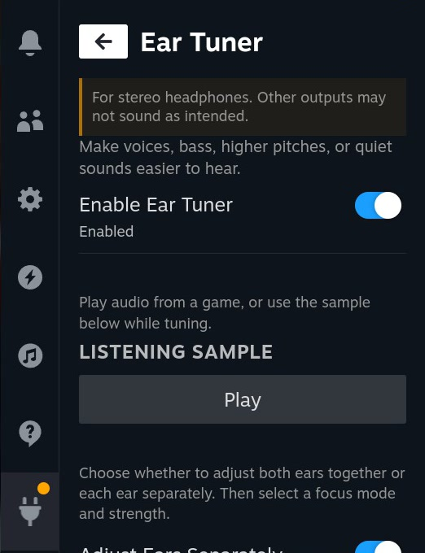
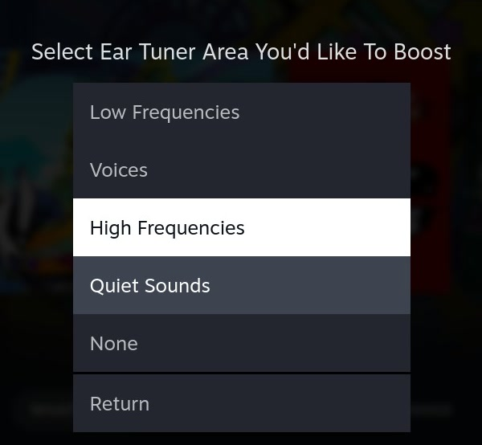
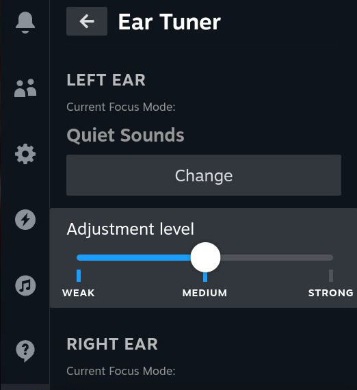
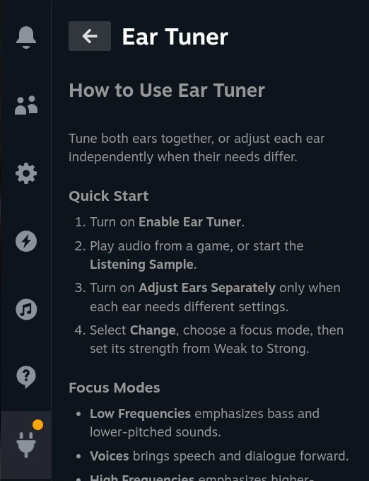

# Ear Tuner

Ear Tuner is a Decky Loader plugin designed to make sounds easier to hear in
games, voice chat, and media. Choose an audio focus and adjustment strength,
using the same settings for both ears or tuning each ear separately.

**Ear Tuner is intended for use only with stereo headphones.**

Ear Tuner does not use an audiogram or calibrated sound levels. Its profiles are
user-controlled starting points, not clinical fittings.

## For Steam Deck and Steam Machine users

**There is no downloadable release yet.** When a beta release is available,
download it from
[GitHub Releases](https://github.com/collinschupman/decky-ear-tuner-plugin/releases)
and follow the installation instructions included with that release. If you need
help installing it, [email me](mailto:collinschupman@gmail.com).

Ear Tuner is not yet available in the Decky Plugin Store.

## Getting started

### 1. Enable Ear Tuner and start listening

Connect stereo headphones, open Ear Tuner from Decky's Quick Access menu, and
turn on **Enable Ear Tuner**. Play audio from a game, or select **Play** under
**Listening Sample** while you tune.

### 2. Choose a focus mode

Select **Change**, then choose the area you want to make easier to hear. Select
**None** to leave that ear unprocessed.

### 3. Set the strength

Start with **Weak**, listen for a moment, and increase the adjustment only if
needed. Stronger is not always better.

By default, the same focus mode and strength apply to both ears. Turn on
**Adjust Ears Separately** only when your ears need different settings, then
configure the left and right ear sections independently.

### 4. Open the built-in guide when needed

Select **Ear Tuner Guide** at the bottom of the plugin for a quick reminder of
the controls and focus modes.

### Focus modes

- **Low Frequencies:** emphasizes bass and lower-pitched sounds.
- **Voices:** brings speech and dialogue forward.
- **High Frequencies:** emphasizes higher-pitched sounds.
- **Quiet Sounds:** raises softer sounds while controlling louder peaks.
- **None:** leaves the selected ear unprocessed.

## Audio output selection

An `ear-tuner` entry may appear in SteamOS audio output settings while the
plugin is running. You don't need to select it; just select your preferred
output normally.

Turn Ear Tuner off when switching from stereo headphones to speakers or another
output.

## I'd love your feedback

Tell me how Ear Tuner works for you: what helps, what doesn't, what feels
confusing, and what you'd like to see next. No technical knowledge needed.

[Report a problem](https://github.com/collinschupman/decky-ear-tuner-plugin/issues/new?template=bug_report.yml)
or
[suggest an idea](https://github.com/collinschupman/decky-ear-tuner-plugin/issues/new?template=feature_request.yml)
through GitHub Issues. For general questions, use
[GitHub Discussions](https://github.com/collinschupman/decky-ear-tuner-plugin/discussions)
or [email me](mailto:collinschupman@gmail.com). For a problem, include your
headphones, settings, and what happened if you can.

## For developers

See the [developer guide](docs/DEVELOPERS.md) to build, test, and extend the
plugin.

Enjoy!

Collin Schupman ([collinschupman@gmail.com](mailto:collinschupman@gmail.com))
